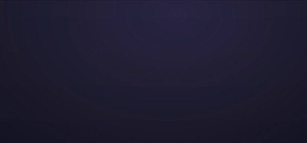

# Isla

[Español](README.md) · **English**

[](https://github.com/oneirozz/Isla/actions/workflows/build.yml)
[](https://ko-fi.com/E6N32AMGD4)

A «dynamic island» for Windows 10/11 written in **C# + WPF**, with no Microsoft
Store and no external dependencies: one self-contained `.exe` and four JSON files.

Built for machines where NotchPixel cannot be installed (LTSC, no Store). Everything
is local: no accounts, no telemetry, no network connections. The interface is in
Spanish.

The island does not sit on screen all the time: it slides out when the cursor reaches
the top centre edge and hides itself again. It can also be shown with a hotkey or
from the tray icon. While collapsed it tells you **what is going on**: an Explorer
copy, the current track, or the time when there is nothing else.

---

## Download

The released build lives in **[Releases](https://github.com/oneirozz/Isla/releases/latest)**:
grab `Isla.exe` and run it. It is a single self-contained file, no installer.

The executable is not signed, so SmartScreen may ask for confirmation the first time
(«More info» → «Run anyway»).

## What is not in the repository

Only source code and documentation are versioned here. `bin/`, `obj/` and `dist/` are
build output: `dotnet build` and `dotnet publish` regenerate them, and keeping 74 MB
binaries in history would bloat the repo forever besides going stale on the next line
of code. The ready-to-run `.exe` is attached to every release.

## What it does

| Module | Status | Detail |
|---|---|---|
| Island | ✅ | Pill attached to the top edge that slides out when the cursor gets close; expands on hover with an animation and simulated glass |
| Activity | ✅ | The collapsed pill shows Explorer copies, moves or deletes, the current track, and the time as a last resort |
| Clock and date | ✅ | System time, date in Spanish (`es-ES`) |
| Music | ✅ | Title, artist, progress and previous / play-pause / next through SMTC or the Winamp (AIMP) API |
| CPU and RAM | ✅ | `GetSystemTimes` and `GlobalMemoryStatusEx`, no libraries |
| Reminders | ✅ | List with an optional time, alert when due, click to complete |
| File shelf | ✅ | Drag files onto the island to keep them at hand |
| Launcher | ✅ | Shortcuts defined in `launcher.json` |
| System tray | ✅ | Show/hide, slide out, effects, hotkeys, start with Windows, data folder, quit |
| Clipboard | ❌ | On purpose: use `Win+V`, which is already native |
| FPS counter | ❌ | See «Limitations» |

## Screenshots

The island slides out when you touch the top edge, expands when the mouse goes over it
and hides itself when you move away:


Island expanded on mouse over:



When it collapses, the pill shows the current activity:


And an Explorer copy, detected while the progress dialog only shows the percentage:


Screenshots taken at 1920×1080 and 100 % scale (Windows 10), cropped to the top of the
screen.

## Requirements

- Windows 10 19041 or newer (Windows 11 included), x64.
- **Nothing else to run the published `.exe`**: it is self-contained and bundles the
  .NET runtime. No Microsoft Store, no installs.
- To build: .NET SDK 8 or newer.

## Run

```powershell
# built (Release)
.\dist\Isla.exe
```

It starts hidden. Move the cursor to the centre of the top edge and the island slides
out; move away and it hides. The first time it stays visible for a few seconds so you
know it is there. It does not appear in the taskbar or in `Alt+Tab`. A second launch
does not create another island: it brings this one back and keeps it visible for a
few seconds.

### Build

The commands assume you are at the root of this repository (the `isla/` folder if you
keep it inside the monorepo).

```powershell
# the SDK installed with scoop may not be on the system PATH
$env:PATH = "C:\Users\<user>\scoop\apps\dotnet-sdk\current;" + $env:PATH

dotnet build Isla.sln -c Release

dotnet publish Isla.csproj -c Release -r win-x64 --self-contained true `
  -p:PublishSingleFile=true -p:IncludeNativeLibrariesForSelfExtract=true `
  -p:EnableCompressionInSingleFile=true -o dist
```

`publish` leaves a single `dist\Isla.exe` of about 74 MB with the runtime inside. To
move it to another PC just copy that file. If you prefer a small executable, publish
with `--self-contained false` and install the **.NET 8 Desktop Runtime** on the target
machine.

### Tests

The logic that does not touch the interface lives in `Isla.Core` and is tested with an
executable of its own, with no xUnit and no NuGet packages:

```powershell
dotnet run --project tests\Isla.Tests -c Release
```

Each case prints `ok` or `FALLO` and the process exits with code 1 if anything fails,
which is what continuous integration checks. It covers Explorer activity detection,
pill priority, island sizing, shelf icons and reminder rules.

## When it shows

The island is a dock that slides out, not a fixed widget:

- **Hot zone:** a 3 DIP strip at the top, centred, `clamp(12% of the screen width, 140,
  260)` DIP wide. At 1920 px that is 230 DIP on each side of the centre.
- **Slide out:** 160 ms fade and 240 ms slide from above.
- **Hide:** 850 ms after the cursor leaves the island (14 DIP margin).
- **Explicit reveal** (hotkey `Ctrl+Alt+N`, tray, second launch): stays visible until
  the cursor enters and leaves once, or 6 s if it never enters.
- **Reminders:** slide out on their own with the alert highlighted, and hide when done.
- While you are typing a reminder the island stays pinned even if the cursor leaves.

The cursor is polled with `GetCursorPos` every 130 ms: no hooks and no noticeable CPU
use. It can be disabled from the tray (**Asomarse al pasar el cursor**); the island
then stays visible all the time.

### What the pill shows

When it collapses it does not fall back to the clock right away: it keeps the last
useful state, in this order:

1. **Explorer activity:** `Copiando…` (copying), `Moviendo…` (moving), `Eliminando…`
   (deleting), `Comprimiendo…` (compressing) or `Extrayendo…` (extracting), each with
   its icon. If the operation starts while the island is hidden, it slides out on its
   own for a few seconds to report it and goes away again.
2. **Music:** track title and a music note. The lavender dot means it is playing; when
   paused the text dims.
3. **Time:** `HH:mm` in discreet grey, only when there is nothing else to report.
   Windows already shows it in the taskbar.

Activity is polled every 800 ms by looking at the visible progress windows of
`explorer.exe`. There is no public global progress API, so this is a heuristic: on
Windows 10 that window is called `OperationStatusWindow` and its title is only the
percentage («84 % completed»), so the operation text is read from its controls through
UI Automation, on a separate thread so it never blocks the interface. It understands
Spanish and English texts. A copy made from another program does not show up as
activity; music does, wherever it comes from.

## Visual effects and GPU

On startup Isla reads the adapter from the registry (`DriverDesc`) and the real
acceleration tier WPF is going to use (`RenderCapability.Tier`). With that it decides
whether to keep the glass shadow, the only effect that costs GPU.

| Mode (tray) | What it does |
|---|---|
| **Automático** (default) | Effects only with a dedicated GPU at tier 2. Turns them off on integrated graphics, Microsoft basic adapters and virtual machines. |
| **Siempre** | Effects even on integrated graphics. |
| **Nunca** | No shadow, for very modest machines or remote sessions. |

On the development machine (Intel HD Graphics, tier 2) Automatic turns them off: it is
an iGPU and the rule is conservative. The decision and the reason are logged:

```text
GPU: "Intel(R) HD Graphics" · tier 2 (full acceleration) · integrated graphics: effects off as a precaution
effects: off (automatic mode)
```

Detection is a name heuristic (Intel HD/UHD/Iris, Radeon without RX/Pro,
VMware/VirtualBox/Hyper-V…), not a DirectX query. It can be changed by hand from the
tray without restarting and is remembered.

## Size

The interface is in DIP (device-independent units): it scales with the Windows zoom,
not with the resolution. The panel width does adapt to the screen so it does not eat
half a laptop screen nor look tiny on a large monitor:

| Measure | Formula |
|---|---|
| Expanded panel | `clamp(30% of the screen width, 340, 480)` DIP |
| Collapsed pill | `clamp(52% of the panel, 200, 260)` DIP |
| Window | panel + 40 DIP margin; height 380 DIP |
| Pill height | 34 DIP |

Examples: 1280 px → panel 384, pill 200; 1366 px → panel 410, pill 213; 1920 px →
panel 480, pill 250; 2560 px or more → panel 480, pill 250. The panel never goes past
480 DIP because beyond that it stops reading comfortably.

## Global hotkeys

| Hotkey | Action |
|---|---|
| `Ctrl+Alt+N` | Show or hide the island (explicit reveal) |
| `Ctrl+Alt+R` | New reminder (opens the text field) |
| `Ctrl+Alt+H` | Hide the island now |
| `Ctrl+Alt+P` | Play / pause the current music |

In the reminder field: `Enter` saves, `Esc` cancels. If another program already uses a
hotkey, Isla notes it in the log and carries on with the rest.

## Music

It reads the system media session first (SMTC), the same one that feeds the volume
flyout: Spotify, Groove, browsers (YouTube, Bandcamp…) and any player that implements
SMTC.

If SMTC has nothing playing, it asks the players that speak the **Winamp API** (AIMP,
Winamp, QCD) through their hidden `Winamp v1.x` window. That is the case for AIMP,
which does not publish SMTC. Title, artist, position, duration and the buttons come
from there; **not** the cover art, which that API does not expose.

The order is: SMTC playing → Winamp playing → SMTC paused → Winamp paused. That way
AIMP shows up without covering Spotify or the browser when either of those does
publish SMTC. If there is nothing, the card shows «Sin reproducción» (nothing
playing) and the controls stay disabled.

## Reminders

They are written in the island field using these forms:

```
Llamar al gestor                      → no time, only listed
Pagar el hosting @18:30               → today (or tomorrow if already past) at 18:30
Comprar café @mañana                  → tomorrow at 09:00
```

Every 20 seconds Isla checks whether one is due: it opens the island, highlights the
text in lavender, plays the Windows notification sound and 8 seconds later goes back
to where it was. The alert is given once per reminder (`Notified` is stored). Clicking
the text marks it as done.

## File shelf

- Drag one or more files (or folders) onto the island: they are kept as chips.
- Click a chip to open it with the default program.
- Drag a chip out of the island to drop it into another application.
- The `×` that appears on hover removes the chip from the shelf (it does not delete
  the file).
- At most 12. If a path no longer exists, it is dropped on startup.

They can also be added from the tray: **«Añadir archivos al estante…»**.

## Data files

Everything lives in `%LOCALAPPDATA%\Isla\`:

| File | Purpose |
|---|---|
| `launcher.json` | Launcher shortcuts (created with examples) |
| `reminders.json` | Reminders, with time and state |
| `shelf.json` | Shelf paths |
| `settings.json` | Slide-out on edge and effects mode |
| `isla.log` | Diagnostics: startup, tracks, errors. Rotated past 1 MB |

They can be edited by hand; the island reads them on startup. If a JSON file is broken,
it logs it and starts with an empty list instead of failing.

### `launcher.json`

```json
[
  {
    "Name": "Notas",
    "Target": "notepad.exe",
    "Glyph": "\uE70F"
  },
  {
    "Name": "Proyectos",
    "Target": "C:\\Users\\me\\Projects",
    "Glyph": null
  }
]
```

- `Target`: executable, document, folder or URI (`ms-settings:`, `https://…`).
- `Glyph`: a **Segoe MDL2 Assets** character. If omitted, the initial is used.

### `reminders.json`

```json
[
  {
    "Id": "a1b2c3d4",
    "Text": "Pagar el hosting",
    "Due": "2026-11-13T18:30:00",
    "Done": false,
    "Notified": false
  }
]
```

### `shelf.json`

```json
[
  "C:\\Users\\me\\Desktop\\budget.xlsx",
  "C:\\Users\\me\\Documents\\contract.pdf"
]
```

### `settings.json`

```json
{
  "RevealOnEdge": true,
  "Effects": "Auto"
}
```

- `RevealOnEdge`: with `false`, the island is always visible.
- `Effects`: `Auto`, `On` or `Off`. Also changed from the tray.

## Limitations (honest ones)

- **No FPS counter.** The real FPS of a game cannot be read from outside without ETW,
  a DirectX hook or injecting code into the process. I would rather not ship an
  invented number or the island's own FPS: that would be a lie. If it is ever needed,
  the way would be a per-process `Present` hook, with the risks that carries.
- **The glass is simulated**, it is not real DWM acrylic. Acrylic applies to the whole
  window rectangle; with an island that changes size every frame you would have to
  recompute the region and the border on each frame, and on Windows 10 the result
  looks worse than a gradient with a shadow.
- **Cover art depends on the player**: if it does not publish `Thumbnail` through
  SMTC, a music note icon is shown. AIMP never publishes it through the Winamp API, so
  with AIMP you always get the icon.
- **Memory**: with the self-contained `.exe`, about 120 MB private and ~270 MB working
  set on the test machine (WPF plus the runtime inside the executable). The
  runtime-dependent variant shares the .NET DLLs and usually uses less. It is not
  Electron, but it is not a 13 MB Win32 app either.
- **No clipboard** by design: `Win+V` already covers it.
- **Explorer activity is a heuristic**: the texts of its progress windows are read (in
  Spanish or English), because Windows does not expose a global progress API. On
  Windows 10 the title is only the percentage, so the operation text comes from the
  controls through UI Automation; if a future version renames those, it will have to
  be adjusted in `ActivityService.cs` and `Isla.Core/ShellActivity.cs`. Copies made
  from other programs are not announced in the pill.
- **Single monitor:** the island is placed on the primary monitor. In a multi-monitor
  setup it does not move to the secondary one.
- **GPU detection is a heuristic** by commercial name, not a DirectX query. If an
  uncommon adapter lands on the wrong side, the effects mode is changed from the tray.
- A game in exclusive fullscreen can sit above the island (it is `Topmost`, but
  exclusive fullscreen wins).

## Structure

```
isla/
  App.xaml / App.xaml.cs          styles, tray, hotkeys, single instance
  IslaWindow.xaml / .xaml.cs      island, animations, modules and wiring
  Isla.Core/                      pure logic, no WPF: used by the app and the tests
    ShellActivity.cs              which operation it is and how its text is recognised
    PillPresenter.cs              what the pill shows and with what priority
    IslandLayout.cs               measurements for a given screen width
    FileGlyphs.cs                 shelf icons by extension
    ReminderRules.cs              parsing, ordering and alerts for reminders
  Services/
    ActivityService.cs            Explorer progress windows (Win32 + UIA)
    MediaService.cs               music: SMTC and Winamp API (AIMP) fallback
    StatsService.cs               CPU and RAM through Win32
    ReminderService.cs            reminders in JSON
    LauncherService.cs            launcher in JSON
    ShelfService.cs               shelf in JSON
    SettingsService.cs            settings: slide-out and effects
    HardwareService.cs            GPU detection and effects recommendation
  Interop/NativeMethods.cs        window styles, hotkeys, sound
  Diagnostics/Log.cs              file log
  tests/Isla.Tests/               Isla.Core tests, console and no xUnit
  docs/screenshots/               screenshots for the README
  app.manifest                    per-monitor DPI, Win10/11 compatibility
```

## Problems

Check `%LOCALAPPDATA%\Isla\isla.log` (from the tray: **Abrir carpeta de datos** — open
data folder). Every start leaves a `--- arranque ---` line and any failure is written
with its exception.

## Contributing and support

Bugs and ideas go to [Issues](https://github.com/oneirozz/Isla/issues), with a
template for each case. To send code, read
[`CONTRIBUTING.md`](CONTRIBUTING.md) first: it explains how to build, the style the
project follows and what is not accepted by design.

Isla is free and will stay free: MIT license, no accounts, no telemetry and no paid
features. If you find it useful and want me to put more hours into it, you can buy me a
coffee:

[](https://ko-fi.com/E6N32AMGD4)

The money goes into development time and testing on real machines. It does not grant
access to anything exclusive or priority: what gets fixed or added depends on its
usefulness, not on who asks or whether they donated.

## License

MIT. See [`LICENSE`](LICENSE).

Copyright (c) 2026 Oneirozz
