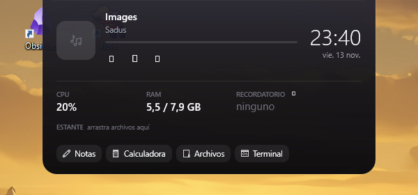

# Isla

[](https://ko-fi.com/E6N32AMGD4)

Una «dynamic island» para Windows 10/11 escrita en **C# + WPF**, sin Microsoft Store
y sin dependencias externas: un `.exe` autocontenido y cuatro archivos JSON.

Pensada para máquinas donde NotchPixel no se puede instalar (LTSC, sin Store).
Todo es local: no hay cuentas, ni telemetría, ni conexiones de red.

La isla no está siempre en pantalla: se asoma cuando el cursor llega al centro del
borde superior y se vuelve a esconder sola. También se puede mostrar con un atajo o
desde la bandeja. Mientras está recogida cuenta **qué está pasando**: una copia del
Explorador, la canción en curso o, si no hay nada, la hora.

---

## Descargar

La versión publicada está en **[Releases](https://github.com/oneirozz/Isla/releases/latest)**:
baja `Isla.exe` y ejecútalo. Es un único archivo autocontenido, sin instalador.

El ejecutable no está firmado, así que SmartScreen puede pedir confirmación la
primera vez («Más información» → «Ejecutar de todas formas»).

## Qué no está en el repositorio

Aquí solo se versiona el código fuente y la documentación. `bin/`, `obj/` y `dist/`
son salida de compilación: `dotnet build` y `dotnet publish` las regeneran, y
guardar binarios de 74 MB en el historial engordaría el repo para siempre, además de
quedar obsoletos en cuanto cambia una línea de código. El `.exe` listo para usar va
adjunto en cada release.

## Qué hace

| Módulo | Estado | Detalle |
|---|---|---|
| Isla | ✅ | Píldora pegada al borde superior que se asoma al acercar el cursor; se expande al pasar el ratón con animación y cristal simulado |
| Actividad | ✅ | La píldora recogida muestra la copia, movimiento o borrado del Explorador, la pista en curso y, como último recurso, la hora |
| Reloj y fecha | ✅ | Hora del sistema, fecha en español (`es-ES`) |
| Música | ✅ | Título, artista, progreso y anterior / play-pausa / siguiente vía SMTC o API de Winamp (AIMP) |
| CPU y RAM | ✅ | `GetSystemTimes` y `GlobalMemoryStatusEx`, sin librerías |
| Recordatorios | ✅ | Lista con hora opcional, aviso al vencer, clic para completar |
| Estante de archivos | ✅ | Arrastra archivos a la isla para tenerlos a mano |
| Lanzador | ✅ | Accesos rápidos definidos en `launcher.json` |
| Bandeja del sistema | ✅ | Mostrar/ocultar, asomarse, efectos, atajos, inicio con Windows, carpeta de datos, salir |
| Portapapeles | ❌ | A propósito: usa `Win+V`, que ya es nativo |
| Contador de FPS | ❌ | Ver «Limitaciones» |

## Capturas

La isla se asoma al tocar el borde superior, se despliega al pasar el ratón por
encima y se esconde sola al apartarlo:


Isla desplegada al pasar el ratón por encima:



Al recogerse, la píldora deja a la vista la actividad en curso:


Capturas tomadas en 1920×1080 al 100 % de escala (Windows 10), recortadas a la
zona superior de la pantalla.

## Requisitos

- Windows 10 19041 o superior (Windows 11 incluido), x64.
- **Nada más para ejecutar el `.exe` publicado**: va autocontenido e incluye el
  runtime de .NET. No hace falta el Microsoft Store ni instalar nada.
- Para compilar: .NET SDK 8 o superior.

## Ejecutar

```powershell
# compilado (Release)
.\dist\Isla.exe
```

Arranca oculta. Lleva el cursor al centro del borde superior y la isla se asoma; al
apartarlo, se esconde. La primera vez se muestra unos segundos para que sepas que
está ahí. No sale en la barra de tareas ni en `Alt+Tab`. Una segunda ejecución no
crea otra isla: la trae y la deja visible unos segundos.

### Compilar

Los comandos suponen que estás en la raíz de este repositorio (la carpeta `isla/` si
lo tienes dentro del monorepo).

```powershell
# el SDK instalado con scoop puede no estar en el PATH del sistema
$env:PATH = "C:\Users\<usuario>\scoop\apps\dotnet-sdk\current;" + $env:PATH

dotnet build Isla.csproj -c Release

dotnet publish Isla.csproj -c Release -r win-x64 --self-contained true `
  -p:PublishSingleFile=true -p:IncludeNativeLibrariesForSelfExtract=true `
  -p:EnableCompressionInSingleFile=true -o dist
```

`publish` deja un único `dist\Isla.exe` de unos 74 MB con el runtime dentro.
Para llevarla a otro PC basta con copiar ese archivo. Si prefieres un ejecutable
pequeño, publica con `--self-contained false` e instala el **.NET 8 Desktop
Runtime** en el equipo de destino.

## Cuándo se muestra

La isla es un dock que se asoma, no un widget fijo:

- **Zona activa:** franja superior de 3 DIP, centrada, de ancho
  `clamp(12% del ancho de pantalla, 140, 260)` DIP. En 1920 px son 230 DIP a cada
  lado del centro.
- **Asomarse:** fundido de 160 ms y deslizamiento desde arriba de 240 ms.
- **Esconderse:** tras 850 ms con el cursor fuera de la isla (14 DIP de margen).
- **Revelado explícito** (atajo `Ctrl+Alt+N`, bandeja, segunda instancia): se queda
  visible hasta que el cursor entra y sale una vez, o 6 s si nunca entra.
- **Recordatorios:** se asoman solos, con el aviso resaltado, y se esconden al
  terminar.
- Mientras escribes un recordatorio, la isla queda fijada aunque el cursor salga.

El cursor se consulta con `GetCursorPos` cada 130 ms: sin hooks ni consumo de CPU
perceptible. Se puede desactivar desde la bandeja (**Asomarse al pasar el cursor**);
entonces la isla vuelve a estar siempre visible.

### Qué cuenta la píldora

Al recogerse no deja la hora: deja el último estado útil, en este orden:

1. **Actividad del Explorador:** `Copiando…`, `Moviendo…`, `Eliminando…`,
   `Comprimiendo…` o `Extrayendo…`, con su icono. Si la operación empieza con la isla
   escondida, se asoma sola unos segundos para contarlo y vuelve a irse.
2. **Música:** título de la pista y nota musical. El punto lavanda indica que suena;
   en pausa el texto se atenúa.
3. **Hora:** `HH:mm` en gris discreto, solo si no hay nada más que contar. Windows ya
   la muestra en la barra de tareas.

La actividad se sondea cada 800 ms mirando las ventanas de progreso visibles de
`explorer.exe`. No hay una API pública de progreso global, así que es una heurística
por título: reconoce los textos en español e inglés de Windows 10/11. Una copia hecha
desde otro programa no aparece como actividad; la música sí, venga de donde venga.

## Efectos visuales y GPU

Al arrancar, Isla lee el adaptador del registro (`DriverDesc`) y el nivel de
aceleración real que va a usar WPF (`RenderCapability.Tier`). Con eso decide si deja
la sombra del cristal, el único efecto que cuesta GPU.

| Modo (bandeja) | Qué hace |
|---|---|
| **Automático** (por defecto) | Efectos solo con GPU dedicada y tier 2. Los desactiva en gráficos integrados, adaptadores básicos de Microsoft y máquinas virtuales. |
| **Siempre** | Efectos aunque la GPU sea integrada. |
| **Nunca** | Sin sombra, para equipos muy justos o sesiones remotas. |

En el equipo de desarrollo (Intel HD Graphics, tier 2) el modo Automático los
desactiva: es una iGPU y el criterio es conservador. La decisión y el motivo quedan
en el log:

```text
GPU: "Intel(R) HD Graphics" · tier 2 (aceleración completa) · gráfico integrado: efectos desactivados por precaución
efectos visuales: desactivados (modo automático)
```

La detección es una heurística por nombre (Intel HD/UHD/Iris, Radeon sin RX/Pro,
VMware/VirtualBox/Hyper-V…), no una consulta a DirectX. Se puede cambiar a mano en
la bandeja sin reiniciar y queda guardado.

## Tamaño

La interfaz está en DIP (unidades independientes de DPI): escala con el zoom de
Windows, no con la resolución. El ancho del panel sí se adapta al de la pantalla para
no ocupar media pantalla en un portátil ni quedar diminuto en un monitor grande:

| Medida | Fórmula |
|---|---|
| Panel desplegado | `clamp(30% del ancho de pantalla, 340, 480)` DIP |
| Píldora recogida | `clamp(52% del panel, 200, 260)` DIP |
| Ventana | panel + 40 DIP de margen; alto 380 DIP |
| Alto de la píldora | 34 DIP |

Ejemplos: 1280 px → panel 384, píldora 200; 1366 px → panel 410, píldora 213;
1920 px → panel 480, píldora 250; 2560 px o más → panel 480, píldora 250. El panel
nunca pasa de 480 DIP porque más ancho deja de leerse cómodo.

## Atajos globales

| Atajo | Acción |
|---|---|
| `Ctrl+Alt+N` | Mostrar u ocultar la isla (revelado explícito) |
| `Ctrl+Alt+R` | Nuevo recordatorio (abre el campo de texto) |
| `Ctrl+Alt+H` | Ocultar la isla ya |
| `Ctrl+Alt+P` | Reproducir / pausar la música actual |

En el campo de recordatorio: `Enter` guarda, `Esc` cancela. Si otro programa ya usa
un atajo, Isla lo anota en el log y sigue con el resto.

## Música

Lee primero la sesión multimedia del sistema (SMTC), la misma que alimenta el panel
de volumen: Spotify, Groove, navegadores (YouTube, Bandcamp…) y cualquier
reproductor que implemente SMTC.

Si por SMTC no hay nada sonando, pregunta a los reproductores con **API de Winamp**
(AIMP, Winamp, QCD) a través de su ventana oculta `Winamp v1.x`. Es el caso de AIMP,
que no publica SMTC. De ahí salen título, artista, posición, duración y los botones;
**no** la carátula, que esa API no expone.

El orden es: SMTC sonando → Winamp sonando → SMTC en pausa → Winamp en pausa. Así
AIMP aparece sin tapar a Spotify o al navegador cuando alguno de esos sí publica
SMTC. Si no hay nada, la tarjeta muestra «Sin reproducción» y los controles quedan
desactivados.

## Recordatorios

Se escriben en el campo de la isla con estas formas:

```
Llamar al gestor                      → sin hora, solo aparece en la lista
Pagar el hosting @18:30               → hoy (o mañana si ya pasó) a las 18:30
Comprar café @mañana                  → mañana a las 09:00
```

Cada 20 segundos Isla comprueba si alguno venció: abre la isla, resalta el texto en
lavanda, suena el aviso de Windows y a los 8 segundos vuelve a su sitio. El aviso
se da una sola vez por recordatorio (`Notified` queda guardado). Clic sobre el
texto lo marca como hecho.

## Estante de archivos

- Arrastra uno o varios archivos (o carpetas) sobre la isla: se guardan como fichas.
- Clic en una ficha lo abre con el programa predeterminado.
- Arrastra una ficha fuera de la isla para sacarla a otra aplicación.
- La `×` que aparece al pasar el ratón quita la ficha del estante (no borra el archivo).
- Máximo 12. Si una ruta deja de existir, se descarta al arrancar.

También se pueden añadir desde la bandeja: **«Añadir archivos al estante…»**.

## Archivos de datos

Todo vive en `%LOCALAPPDATA%\Isla\`:

| Archivo | Para qué |
|---|---|
| `launcher.json` | Accesos rápidos del lanzador (se crea con ejemplos) |
| `reminders.json` | Recordatorios, con hora y estado |
| `shelf.json` | Rutas del estante |
| `settings.json` | Asomarse al borde y modo de efectos |
| `isla.log` | Diagnóstico: arranque, pistas, errores. Se rota al pasar de 1 MB |

Se editan a mano sin problema; la isla los lee al arrancar. Si un JSON está roto,
lo anota en el log y arranca con la lista vacía en vez de fallar.

### `launcher.json`

```json
[
  {
    "Name": "Notas",
    "Target": "notepad.exe",
    "Glyph": "\uE70F"
  },
  {
    "Name": "Proyectos",
    "Target": "C:\\Users\\yo\\Proyectos",
    "Glyph": null
  }
]
```

- `Target`: ejecutable, documento, carpeta o URI (`ms-settings:`, `https://…`).
- `Glyph`: carácter de **Segoe MDL2 Assets**. Si se omite, se usa la inicial.

### `reminders.json`

```json
[
  {
    "Id": "a1b2c3d4",
    "Text": "Pagar el hosting",
    "Due": "2026-11-13T18:30:00",
    "Done": false,
    "Notified": false
  }
]
```

### `shelf.json`

```json
[
  "C:\\Users\\yo\\Escritorio\\presupuesto.xlsx",
  "C:\\Users\\yo\\Documentos\\contrato.pdf"
]
```

### `settings.json`

```json
{
  "RevealOnEdge": true,
  "Effects": "Auto"
}
```

- `RevealOnEdge`: con `false`, la isla está siempre visible.
- `Effects`: `Auto`, `On` u `Off`. También se cambia desde la bandeja.

## Limitaciones (honestas)

- **No hay contador de FPS.** El FPS real de un juego no se puede leer desde fuera
  sin ETW, un hook de DirectX o inyectar código en el proceso. Prefiero no poner un
  número inventado o el FPS de la propia isla: sería mentira. Si algún día hace
  falta, la vía sería un hook de `Present` por proceso, con los riesgos que tiene.
- **El cristal es simulado**, no es el acrílico real de DWM. El acrílico se aplica
  al rectángulo completo de la ventana; con una isla que cambia de tamaño en cada
  fotograma habría que recalcular la región y el borde, y en Windows 10 el
  resultado es peor que un degradado con sombra.
- **La carátula depende del reproductor**: si no publica `Thumbnail` por SMTC, se
  muestra el icono de nota musical. AIMP nunca la publica por la API de Winamp, así
  que con AIMP siempre sale el icono.
- **Memoria**: con el `.exe` autocontenido, unos 120 MB privados y ~270 MB de
  working set en el equipo de pruebas (WPF más el runtime dentro del ejecutable). La
  variante dependiente del runtime comparte las DLL de .NET y suele gastar menos. No
  es Electron, pero tampoco una app Win32 de 13 MB.
- **Sin portapapeles** por decisión de diseño: `Win+V` ya lo cubre.
- **La actividad del Explorador es una heurística**: se leen los títulos de sus
  ventanas de progreso (en español o inglés), porque Windows no expone una API de
  progreso global. Las copias hechas desde otros programas no se anuncian en la
  píldora; si el Explorador cambia esos textos en una versión futura, habrá que
  añadirlos a `ActivityService.cs`.
- **Un solo monitor:** la isla se coloca en el monitor principal. En una configuración
  multimonitor no se mueve al secundario.
- **La detección de GPU es una heurística** por nombre comercial, no una consulta a
  DirectX. Si un adaptador poco común cae en el lado equivocado, el modo de efectos
  se cambia desde la bandeja.
- Un juego en pantalla completa exclusiva puede quedar por encima de la isla
  (es `Topmost`, pero el fullscreen exclusivo manda).

## Estructura

```
isla/
  App.xaml / App.xaml.cs          estilos, bandeja, atajos, instancia única
  IslaWindow.xaml / .xaml.cs      isla, animaciones, módulos y cableado
  Services/
    ActivityService.cs            copias y operaciones del Explorador para la píldora
    MediaService.cs               música: SMTC y respaldo API de Winamp (AIMP)
    StatsService.cs               CPU y RAM por Win32
    ReminderService.cs            recordatorios en JSON
    LauncherService.cs            lanzador en JSON
    ShelfService.cs               estante en JSON
    SettingsService.cs            ajustes: asomarse y efectos
    HardwareService.cs            detección de GPU y recomendación de efectos
  Interop/NativeMethods.cs        estilos de ventana, atajos, sonido
  Diagnostics/Log.cs              log a archivo
  docs/screenshots/               capturas para el README
  app.manifest                    DPI por monitor, compatibilidad Win10/11
```

## Problemas

Mira `%LOCALAPPDATA%\Isla\isla.log` (desde la bandeja: **Abrir carpeta de datos**).
Cada arranque deja una línea `--- arranque ---` y cualquier fallo se escribe con su
excepción.

## Contribuir y apoyar

Los fallos y las ideas van en [Issues](https://github.com/oneirozz/Isla/issues), con
plantilla para cada caso. Para enviar código, lee antes
[`CONTRIBUTING.md`](CONTRIBUTING.md): explica cómo compilar, qué estilo sigue el
proyecto y qué cosas no se aceptan por diseño.

Isla es gratis y seguirá siéndolo: licencia MIT, sin cuentas, sin telemetría y sin
funciones de pago. Si te resulta útil y quieres que le dedique más horas, puedes
invitarme a un café:

[](https://ko-fi.com/E6N32AMGD4)

El dinero va a tiempo de desarrollo y a probar en equipos reales. No da acceso a nada
exclusivo ni prioridad: lo que se arregla o se añade depende de su utilidad, no de
quién lo pida ni de si ha donado.

## Licencia

MIT. Consulta [`LICENSE`](LICENSE).

Copyright (c) 2026 Oneirozz
